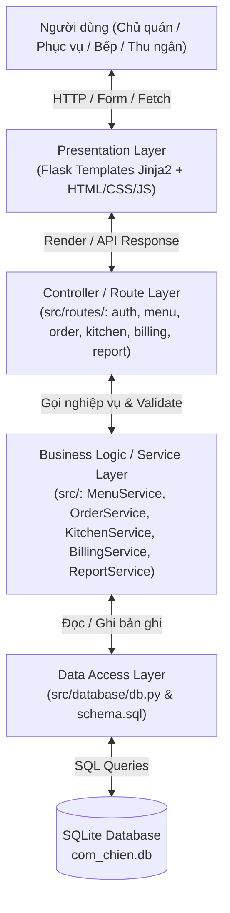
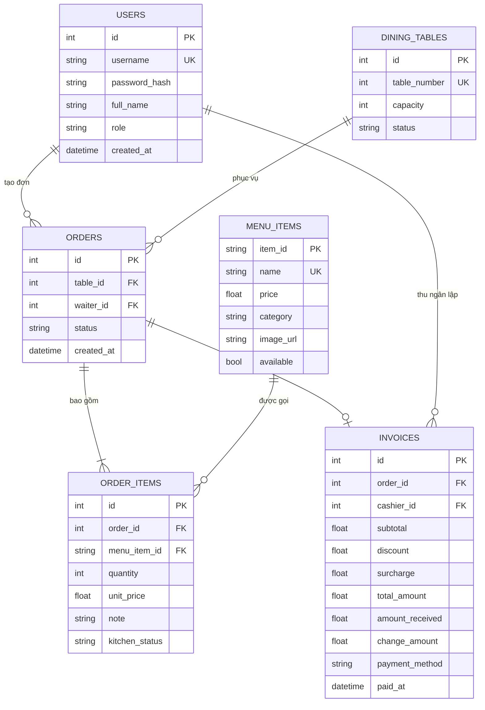
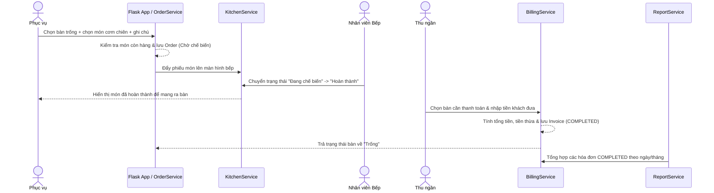

# Kiến trúc Hệ thống Phần mềm — Quản lý và Đặt món Quán Cơm Chiên (Nhóm 5)

Tài liệu này mô tả định hướng kiến trúc, lựa chọn công nghệ (Tech Stack), cấu trúc thư mục, thiết kế cơ sở dữ liệu dự kiến và quy chuẩn phát triển mã nguồn được thống nhất trong **Sprint 0** trước khi bước vào **Sprint 1**.

---

## 1. Lựa chọn Công nghệ (Tech Stack) & Lý do

| Thành phần | Công nghệ lựa chọn | Lý do lựa chọn |
| :--- | :--- | :--- |
| **Ngôn ngữ lập trình** | **Python 3.12+** | Nhóm đã sử dụng xuyên suốt từ Chương 4; cú pháp rõ ràng, dễ bảo trì và có sẵn các module nghiệp vụ (`src/*_service.py`). |
| **Web Framework (Backend)** | **Flask (`>=3.0,<4.0`)** | Gọn nhẹ, dễ học, cấu trúc linh hoạt phù hợp với quy mô đồ án môn học; hỗ trợ Blueprint để chia module theo từng thành viên. |
| **Giao diện (Frontend)** | **HTML5, CSS3, JavaScript + Jinja2** | Tích hợp trực tiếp với Flask templates, không cần tách build phức tạp, đáp ứng tốt giao diện đặt món tại bàn, màn hình bếp và báo cáo. |
| **Cơ sở dữ liệu (Database)** | **SQLite (`sqlite3` chuẩn Python)** | Không cần cài đặt server DB riêng; chỉ cần 1 file `.db` chạy ổn định trên máy cả 5 thành viên ngay sau khi `git clone`. |
| **Kiểm thử (Testing)** | **`unittest` (Cấu trúc AAA)** | Thư viện chuẩn của Python, đồng bộ với 21 Unit Test hiện có ở `tests/`, chạy nhanh không phụ thuộc công cụ ngoài. |
| **Quản lý mã nguồn & Công việc** | **Git, GitHub, Trello** | Quản lý Product Backlog & Sprint trên Trello; phân nhánh Feature Branch Workflow và Review chéo PR trên GitHub. |

---

## 2. Mô hình Kiến trúc Hệ thống (3-Layer + MVC)

Hệ thống áp dụng **Kiến trúc 3 lớp (3-Tier / Layered Architecture)** kết hợp mô hình **MVC** của Flask nhằm tách biệt rõ giao diện, điều phối request, xử lý nghiệp vụ và truy xuất dữ liệu.

- **Tầng Trình bày (Presentation Layer):** `templates/` (Jinja2 HTML) và `static/` (CSS, JS) hiển thị màn hình cho Chủ quán, Phục vụ, Bếp, Thu ngân.
- **Tầng Điều phối (Controller / Route Layer):** `src/routes/` (Flask Blueprints) nhận HTTP request, kiểm tra session/phân quyền, gọi Service và trả về giao diện hoặc JSON.
- **Tầng Nghiệp vụ (Business Logic / Service Layer):** `src/services/` kế thừa trực tiếp các lớp xử lý đã xây dựng ở Chương 4 (`MenuService`, `OrderService`, `KitchenService`, `BillingService`, `ReportService`) và kiểm tra toàn bộ quy tắc nghiệp vụ.
- **Tầng Truy xuất Dữ liệu (Data Access Layer):** `src/database/` cung cấp kết nối SQLite (`sqlite3`) và các câu truy vấn SQL có tham số hóa (parameterized queries) để tránh SQL Injection.



---

## 3. Cấu trúc Thư mục Dự án (Khởi tạo tại Sprint 0, Mở rộng ở Sprint 1+)

Khung dự án đã được khởi tạo theo cấu trúc 3 lớp chuẩn hóa để cả 5 thành viên có sẵn file riêng (`src/routes/*_routes.py` và `src/*_service.py`), hạn chế xung đột khi làm song song từ Sprint 1:

```text
NHAPMON_CNPM_NHOM-5_QUAN-LY-COM-CHIEN/
├── .env.example                # Mẫu biến môi trường cục bộ
├── .gitignore                  # Bỏ qua venv, pycache, file SQLite (*.db) và instance/
├── app.py                      # Điểm khởi chạy ứng dụng Web Flask (create_app)
├── requirements.txt            # Danh sách thư viện Python (Flask>=3.0,<4.0)
├── README.md                   # Thông tin tổng quan, thành viên, hướng dẫn cài đặt
├── docs/                       # Tài liệu dự án (Backlog, Kiến trúc, Sprint 0, ERD, Wireframes)
│   ├── PRODUCT_BACKLOG.md
│   ├── ARCHITECTURE.md
│   └── SPRINT_0_PLAN.md
├── src/                        # Mã nguồn Backend
│   ├── __init__.py
│   ├── config.py               # Cấu hình ứng dụng (SECRET_KEY, DATABASE_PATH)
│   ├── menu_service.py         # (Đã có - PR #6) Nghiệp vụ Thực đơn
│   ├── order_service.py        # (Đã có - PR #10) Nghiệp vụ Đặt món & Bàn ăn
│   ├── kitchen_service.py      # (Đã có - PR #9) Nghiệp vụ Trạng thái bếp
│   ├── billing_service.py      # (Đã có - PR #7) Nghiệp vụ Thanh toán & Hóa đơn
│   ├── report_service.py       # (Đã có - PR #8) Nghiệp vụ Báo cáo doanh thu
│   ├── auth_service.py         # (Sprint 2) Nghiệp vụ Đăng nhập & Phân quyền
│   ├── database/               # Tầng truy xuất CSDL SQLite
│   │   ├── __init__.py
│   │   ├── db.py               # get_connection, init_db, get_db_summary
│   │   └── schema.sql          # Định nghĩa 6 bảng & dữ liệu mẫu bàn ăn, thực đơn
│   └── routes/                 # Tầng Controller (Flask Blueprints cho từng phân hệ)
│       ├── __init__.py
│       ├── helpers.py          # Danh mục module & helper tạo Blueprint khung
│       ├── main_routes.py      # Trang chủ (/) và API kiểm tra hệ thống (/health)
│       ├── menu_routes.py      # (/menu) Quản lý thực đơn — Hoàng Thái Minh
│       ├── order_routes.py     # (/orders) Đặt món tại bàn — Nguyễn Đình Mạnh
│       ├── kitchen_routes.py   # (/kitchen) Màn hình bếp — Lê Văn Chương
│       ├── billing_routes.py   # (/billing) Thanh toán & Hóa đơn — Đào Hữu Thiện
│       └── report_routes.py    # (/reports) Thống kê Doanh thu — Đặng Tuấn Kiệt
├── templates/                  # Giao diện HTML (Jinja2)
│   ├── base.html
│   ├── index.html
│   └── module_placeholder.html
├── static/                     # Tài nguyên tĩnh (CSS, JS, ảnh)
│   └── css/
│       └── style.css
└── tests/                      # Unit Test & Smoke Test theo cấu trúc AAA (unittest)
    ├── __init__.py
    ├── test_app_setup.py       # (Sprint 0 - 4 tests) Kiểm thử DB 6 bảng, /, /health, 5 routes
    ├── test_menu.py            # (Đã có - PR #6 - 5 tests)
    ├── test_order.py           # (Đã có - PR #10 - 6 tests)
    ├── test_kitchen.py         # (Đã có - PR #9 - 4 tests)
    ├── test_billing.py         # (Đã có - PR #7 - 4 tests)
    └── test_report.py          # (Đã có - PR #8 - 8 tests)
```

---

## 4. Thiết kế Cơ sở Dữ liệu Dự kiến (SQLite)

Hệ thống sử dụng **6 bảng dữ liệu chính** đáp ứng toàn bộ 10 User Stories:



### Mô tả ngắn các bảng:
1. **`users`:** Lưu tài khoản nhân sự và vai trò (`ADMIN`, `WAITER`, `KITCHEN`, `CASHIER`).
2. **`menu_items`:** Lưu danh sách món cơm chiên/đồ uống, giá bán, danh mục, ảnh và cờ `available` (còn/hết món).
3. **`dining_tables`:** Quản lý số bàn, sức chứa và trạng thái (`TRONG`, `DANG_PHUC_VU`, `CHO_THANH_TOAN`).
4. **`orders`:** Lưu thông tin đơn hàng theo bàn (`OPEN`, `COMPLETED`, `CANCELLED`).
5. **`order_items`:** Chi tiết từng món trong đơn, ghi chú chế biến và trạng thái bếp (`Chờ chế biến` → `Đang chế biến` → `Hoàn thành`).
6. **`invoices`:** Hóa đơn đã thanh toán, lưu tổng tiền, giảm giá, phụ thu, tiền khách đưa, tiền thừa và thời điểm thanh toán để thống kê doanh thu.

---

## 5. Luồng Xử lý Nghiệp vụ Cốt lõi (End-to-End)



---

## 6. Quy chuẩn Làm việc Nhóm trên Git & Kiểm thử

1. **Bảo vệ nhánh `main`:** Không code trực tiếp trên `main`. Mọi thay đổi đều thực hiện trên nhánh riêng (`feature/<ten-chuc-nang>` hoặc `fix/<ten-loi>`).
2. **Pull Request & Review chéo:** Mỗi PR cần có mô tả rõ ràng, liên kết Issue tương ứng và phải có ít nhất **1 thành viên khác Review & Approve** trước khi merge vào `main`.
3. **Unit Test bắt buộc:** Mọi logic nghiệp vụ mới/sửa đổi phải đi kèm Unit Test theo cấu trúc **AAA (`Arrange - Act - Assert`)** trong `tests/` và chạy `python -m unittest discover -s tests -v` pass 100% trước khi merge.
